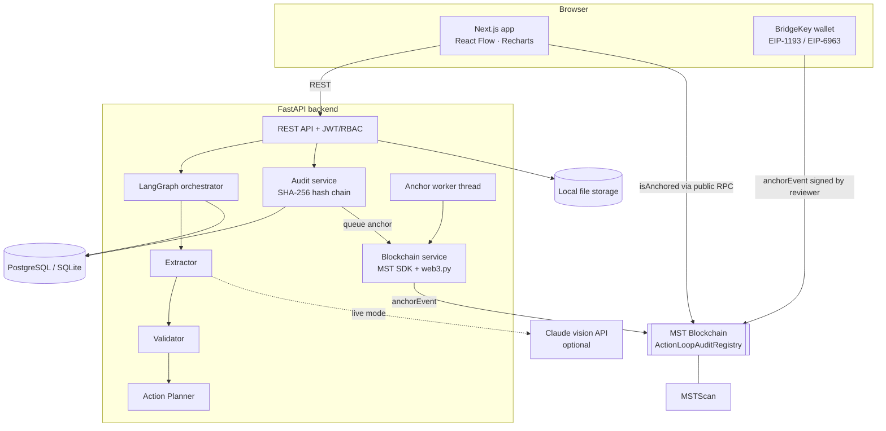

# ActionLoop Architecture

## System overview



## Repository layout

```
ActionLoop/
├── backend/                 FastAPI + LangGraph + blockchain services
│   ├── app/
│   │   ├── main.py          app factory, lifespan (create tables, seed, anchor worker)
│   │   ├── core/            config (env), security (JWT, bcrypt, RBAC)
│   │   ├── api/routes/      auth, documents, workflows, agents, approvals, audit, analytics, blockchain, settings
│   │   ├── agents/          extractor.py, validator.py, action_planner.py, document_types.py
│   │   ├── orchestration/   graph.py (LangGraph), state.py
│   │   ├── services/        audit_service, workflow_service, analytics_service, storage
│   │   ├── blockchain/      network_config, mst_client, contract_service, transaction_service, verification_service, abi/
│   │   ├── models/          SQLAlchemy entities
│   │   ├── schemas/         Pydantic request/response models
│   │   ├── database/        session, seed
│   │   └── utils/           sample document generator
│   ├── scripts/e2e_chain_check.py
│   └── tests/
├── contracts/               Hardhat project: ActionLoopAuditRegistry.sol, tests, deploy + ABI export scripts
├── frontend/                Next.js App Router app
├── samples/                 Demo documents A–G + ground_truth.json
└── docs/                    Technical documentation (01–18)
```

## Key design decisions

1. **LLM never decides validity.** Extraction can use an LLM; validation and the approval policy are deterministic code + database queries.
2. **Persistent approval checkpoint.** The processing graph ends at `await_approval` after storing the full graph state in `workflows.checkpoint`. A reviewer decision starts the resume graph from that state, so approvals survive restarts.
3. **Append-only audit.** ORM `before_update`/`before_delete` listeners raise; on PostgreSQL a trigger also blocks UPDATE/DELETE. Hashes are chained from a genesis hash of 64 zeros.
4. **Two-layer proof.** Full data stays off-chain. Only the audit event hash (which commits to every earlier event), a hashed workflow ID, an event label and the submitter go on-chain.
5. **Honest status.** Blockchain status is "confirmed" only after a successful receipt *and* the contract confirming the hash. Without a deployed contract, anchors are `not_configured` — never faked.
6. **Idempotent anchoring.** One anchor row per (chain, event hash); the worker checks `isAnchored` before (re)submitting; the contract reverts duplicates.

Detailed docs: [docs/04_System_Architecture.md](docs/04_System_Architecture.md), [docs/06_Multi_Agent_Workflow.md](docs/06_Multi_Agent_Workflow.md), [docs/18_MST_Blockchain_Integration.md](docs/18_MST_Blockchain_Integration.md).
