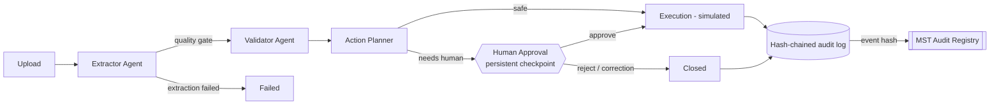

# ActionLoop

**From Documents to Decisions. Automatically.**

AI-powered multi-agent workflow automation with human approval, a SHA-256 hash-chained audit trail, and on-chain verification on **MST Blockchain**.

> Built for **MST Blockchain Buildathon 2.0** by **Team Granted** — Aditya Shelke, Tejas Bankar, Siddhika Hanumante
> Nutan Maharashtra Institute of Engineering and Technology (NMIET), Pune

---

## 1. Problem

Colleges, clinics, small businesses and admin offices still process invoices, admission forms, fee receipts, patient registrations and complaints by hand. Fields are retyped, missing data is discovered late, the same invoice gets paid twice, and nobody can later *prove* who approved what.

## 2. Solution

ActionLoop runs every document through three specialised agents orchestrated with **LangGraph**:

| Agent | What it does | How |
|---|---|---|
| **Extractor** | Classifies the document and extracts structured fields with per-field confidence | Claude vision model (live) · deterministic PDF parser (DEMO MODE) |
| **Validator** | Required fields, formats, ranges, dates, duplicate detection against the database | Deterministic, configurable rules — never an LLM |
| **Action Planner** | Ordered plan with department, priority, impact, reasoning; decides what needs a human | Deterministic policy |

Uncertain or high-impact cases pause at a **persistent human-approval checkpoint**. Every step is written to an **append-only, SHA-256 hash-chained audit log**, and key decisions are **anchored on MST Blockchain** through the `ActionLoopAuditRegistry` smart contract so anyone can verify them on MSTScan.

## 3. Key features

- Drag-and-drop upload (PDF/JPG/PNG, type + magic-byte + size checks) with live preview
- Live stage tracking: Uploaded → Extracting → Validating → Planning → Approval → Completed
- **Workflow Studio** — interactive React Flow graph of the agents with per-node execution detail, retry and run history
- **Agent Intelligence Center** — extracted fields & confidence, validation checklist, duplicate check, recommended actions
- **Approval Center** — approve / reject / request correction, inline field corrections that are re-validated before execution
- **Audit & Traceability** — search, filters, timeline, full-chain verification, tamper simulation, CSV export
- **MST Blockchain** — audit registry contract, backend relayer, BridgeKey wallet signing, receipt + `isAnchored()` verification, MSTScan links, independent browser-side RPC check
- Analytics with date filters and CSV export; validation-rule configuration; light/dark theme
- **DEMO MODE** works with no paid API; all external actions are clearly simulated

## 4. Multi-agent architecture



See [ARCHITECTURE.md](ARCHITECTURE.md) and [docs/](docs/).

## 5. Technology stack

| Layer | Technology |
|---|---|
| Frontend | Next.js 15 (App Router), TypeScript, Tailwind CSS 4, Radix/shadcn-style components, Framer Motion, Lucide, Recharts, React Flow (`@xyflow/react`), ethers v6 |
| Backend | FastAPI, Pydantic v2, SQLAlchemy 2, JWT (PyJWT) + bcrypt |
| AI | LangGraph 1.x orchestration, Anthropic Claude (`claude-opus-5-5`) vision + structured JSON output |
| Database | PostgreSQL (Docker) · SQLite fallback for zero-setup local dev |
| Blockchain | Solidity 0.8.24, Hardhat, **MST Python SDK (`mst-sdk-python`)**, web3.py, BridgeKey (EIP-1193/EIP-6963) |
| Infra | Docker Compose |

## 6. MST Blockchain integration

| Item | Value |
|---|---|
| Contract | [`contracts/contracts/ActionLoopAuditRegistry.sol`](contracts/contracts/ActionLoopAuditRegistry.sol) |
| MST Testnet | RPC `https://testnetrpc.mstblockchain.com` · chain `91562037` · explorer https://testnet.mstscan.com |
| MST Mainnet | RPC `https://mariorpc.mstblockchain.com` · chain `4646` · explorer https://mstscan.com |
| **Testnet contract address** | _pending deployment — see [docs/18_MST_Blockchain_Integration.md](docs/18_MST_Blockchain_Integration.md)_ |
| **Testnet transaction hashes** | _pending deployment_ |
| **Mainnet contract address** | _pending (requires buildathon mainnet funds and explicit confirmation)_ |

Both RPC endpoints and chain IDs were verified live with `eth_chainId` (0x5752035 = 91562037, 0x1226 = 4646).

**What goes on-chain:** event hash (the audit chain hash), SHA-256 of the workflow UUID, an event-type label, the submitting address and block timestamp. **Never** document contents, names, amounts or other personal data.

**Success is only shown after** a successful transaction receipt *and* `isAnchored(eventHash) == true` on the contract.

## 7. Quick start (local, no Docker)

Prerequisites: Python 3.12+ (tested on 3.14), Node.js 20+.

```bash
# backend
cd backend
python -m venv .venv
.venv/Scripts/activate            # Windows  (macOS/Linux: source .venv/bin/activate)
pip install -r requirements.txt
cp .env.example .env              # edit JWT_SECRET; leave ANTHROPIC_API_KEY empty for DEMO MODE
uvicorn app.main:app --reload --port 8000
```

```bash
# frontend (new terminal)
cd frontend
npm install
npm run dev                       # http://localhost:3000
```

The backend creates tables, seeds the demo organization/users/rules/history and registers the sample documents in `samples/` on first start (SQLite file `backend/actionloop.db`).

### With Docker (PostgreSQL)

```bash
cp backend/.env.example backend/.env
docker compose up --build         # frontend :3000, backend :8000, postgres :5432
```

> The Docker setup is provided but was not executed in our build environment (no Docker available there). Local SQLite mode is what we tested.

## 8. Environment setup

All configuration is via environment variables — see [`backend/.env.example`](backend/.env.example) and [`frontend/.env.example`](frontend/.env.example). `.env` files are git-ignored. No secrets are hard-coded or sent to the browser.

## 9. Demo credentials

Password for every account: `ActionLoop@2026`

| Email | Role | Can |
|---|---|---|
| `reviewer@actionloop.demo` | reviewer | approve / reject / correct, anchor events |
| `admin@actionloop.demo` | admin | everything + rule configuration + authorize wallets on-chain |
| `operator@actionloop.demo` | operator | upload and start workflows |
| `viewer@actionloop.demo` | viewer | read-only |

## 10. Demo scenarios (`samples/`)

| File | Scenario | Expected outcome |
|---|---|---|
| `A_invoice_pune_techsupplies.pdf` | Successful processing | Validation passes → payment review needs approval → completes |
| `B_admission_form_missing_field.pdf` | Missing information | Guardian name missing → correction requested |
| `C_invoice_duplicate.pdf` | Duplicate detection | Matches an invoice processed on 4 Sep 2026 → blocked |
| `D_fee_receipt_unclear_amount.pdf` | Low confidence | Amount/date unreadable → human verification → approve with corrections |
| `E_complaint_email_hostel_leak.pdf` | Complaint processing | Facilities & Maintenance, high urgency → Estate office |
| `F_clinic_registration.pdf` | Clean registration | Completes automatically, no approval |
| `G_invoice_photo.png` | Image in DEMO MODE | No vision model → no fields invented → manual triage |

Walkthrough: [docs/16_Hackathon_Demo_Guide.md](docs/16_Hackathon_Demo_Guide.md).

## 11. API documentation

Interactive Swagger UI: **http://localhost:8000/docs** (ReDoc at `/redoc`). Summary in [docs/08_API_Documentation.md](docs/08_API_Documentation.md).

## 12. Testing

```bash
cd backend && .venv/Scripts/python -m pytest          # 28 tests: API, auth, scenarios, audit chain, tamper detection
cd contracts && npx hardhat test                       # 10 contract tests
cd backend && .venv/Scripts/python scripts/e2e_chain_check.py --local   # real EVM end-to-end (needs `npx hardhat node`)
cd frontend && npx tsc --noEmit && npm run build
```

Latest results are recorded in [docs/13_Testing_and_Evaluation.md](docs/13_Testing_and_Evaluation.md).

## 13. Screenshots

Add screenshots of the landing page, dashboard, Workflow Studio, Approval Center, Audit page and MST Blockchain page to `docs/screenshots/` before submission.

## 14. Future enhancements

See [docs/17_Future_Scope.md](docs/17_Future_Scope.md): real connectors (ERP/email/SIS), OCR fallback for scans, Merkle-batched anchoring, multi-tenant RBAC, object storage, Alembic migrations.

## License

MIT — for the buildathon. Sample documents contain fictitious data.
