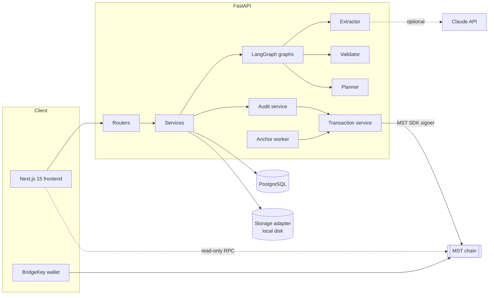

# 04 · System Architecture

### Layers

| Layer | Modules | Responsibility |
|---|---|---|
| API | `app/api/routes/*` | Validation (Pydantic), auth (JWT), RBAC, error handling |
| Orchestration | `app/orchestration/graph.py` | LangGraph processing + resume graphs, conditional edges |
| Agents | `app/agents/*` | Extraction, deterministic validation, planning policy |
| Services | `app/services/*` | Workflow lifecycle, audit chain, analytics, storage adapter |
| Blockchain | `app/blockchain/*` | Network config, MST SDK client, contract I/O, anchoring, verification |
| Data | `app/models`, `app/database` | SQLAlchemy models, session, seed |

### Concurrency

Workflows run in background threads so the API returns immediately (`202`). A process-wide lock serialises audit appends (sequence + previous hash cannot fork). A single anchor worker thread submits transactions one at a time, keeping relayer nonces sequential.

### Storage

`StorageAdapter` interface with `LocalStorage` (server-generated filenames, path traversal guarded). `ObjectStorage` is a documented, **unimplemented** placeholder for S3/GCS.
