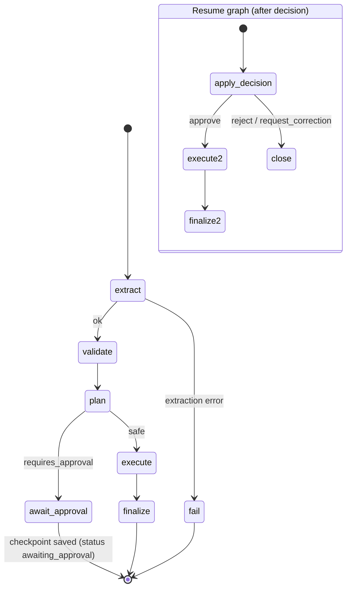

# 06 · Multi-Agent Workflow (LangGraph)

Implemented in `backend/app/orchestration/graph.py` with `StateGraph(WorkflowState)` and conditional edges.

| Node | Writes | Audit event |
|---|---|---|
| `extract` | `extracted_fields`, `agent_executions` | `EXTRACTION_COMPLETED` / `EXTRACTION_FAILED` |
| `validate` | `validation_results` | `VALIDATION_COMPLETED`, `VALIDATION_BLOCKED` (duplicates) |
| `plan` | `action_plans`, approval flags | `PLAN_CREATED` |
| `await_approval` | `approvals` (pending), `workflows.checkpoint` | `APPROVAL_REQUESTED` |
| decision API | approval row | `APPROVAL_DECISION` *(anchored)* |
| `apply_decision` | corrected fields → re-runs validate + plan | (validation/plan events) |
| `execute` | action statuses (simulated) | `ACTIONS_EXECUTED` |
| `finalize` / `close` / `fail` | outcome, duration | `WORKFLOW_COMPLETED` *(anchored)*, `WORKFLOW_REJECTED` *(anchored)*, `CORRECTION_REQUESTED`, `WORKFLOW_FAILED` |

### Rules that cannot be bypassed

- Extraction failure → `fail` node with an understandable error; retry via `POST /api/workflows/{id}/retry`.
- Low-confidence or unreadable fields → `ALL_CONFIDENCE` warning + approval reason.
- Validation failures → plan is blocked (`request_correction`, `human_verification` or `block_duplicate`), always requiring approval.
- High-impact actions (payments, admission decisions) → approval required even when validation passes.
- Duplicate submissions → `409` if the document already has an active workflow.

### Approval checkpoint

LangGraph's in-memory checkpointers don't survive restarts and the Postgres checkpointer would add another dependency, so we use the equivalent the brief allows: the graph state at `await_approval` is persisted as JSON in `workflows.checkpoint`, and the resume graph starts from it.
