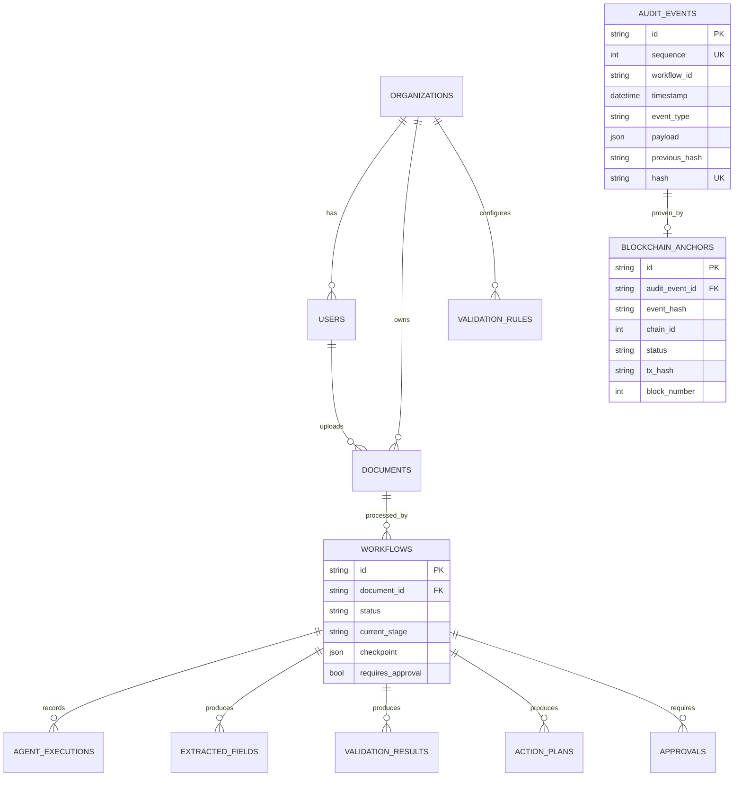

# 07 · Database Design

Tables are created by SQLAlchemy (`Base.metadata.create_all`) on startup. Large files are stored on disk; the database keeps metadata and a storage key.

| Table | Purpose | Notable constraints / indexes |
|---|---|---|
| `organizations` | Tenant | — |
| `users` | Accounts, bcrypt hash, role | unique `email` |
| `documents` | File metadata, SHA-256, storage key, detected type | index `sha256`, `status`, `created_at` |
| `workflows` | Lifecycle, approval flags, persisted checkpoint | index `status`, `document_id` |
| `agent_executions` | Per-agent run: input, output, explanation, engine, duration | index `workflow_id` |
| `extracted_fields` | Field value, confidence, status | index (`name`,`value`) for duplicate lookup |
| `validation_rules` | Configurable rules | unique (`organization_id`,`code`) |
| `validation_results` | Rule outcomes with explanations | index `workflow_id` |
| `action_plans` | Ordered actions | index `workflow_id` |
| `approvals` | Reviewer, decision, comment, corrections, timestamps | index `status` |
| `audit_events` | Append-only hash chain | unique `sequence`, unique `hash` |
| `contract_deployments` | Deployed contract registry | unique (`chain_id`,`address`) |
| `blockchain_anchors` | Off-chain ↔ on-chain link | unique (`chain_id`,`event_hash`) |

**Append-only enforcement:** SQLAlchemy listeners reject UPDATE/DELETE on `audit_events`; on PostgreSQL a `BEFORE UPDATE OR DELETE` trigger is installed at startup.

**Migrations:** schema is created from models; Alembic migrations are listed as future work.
