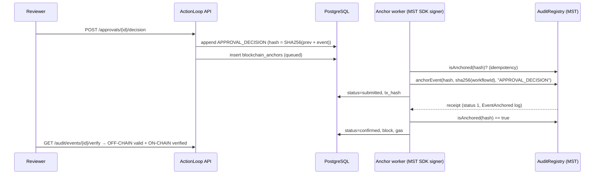

# 18 · MST Blockchain Integration

## A. What the official documentation establishes (verified 31 Oct 2026)

Sources: docs.mstblockchain.com (Testnet, SDKs, JavaScript SDK, Python SDK, Vibe Kit, Deployment on Mainnet, Gas, Accounts), the npm/PyPI packages, and the buildathon guide PDF.

| Fact | Source | Verified how |
|---|---|---|
| MST is EVM-compatible; Solidity contracts (docs example `pragma ^0.8.24`) | Docs home, SDK overview | — |
| Hardhat and Foundry are the documented deployment tools; Remix + OpenZeppelin for hands-on | Deployment on Mainnet, IDE page | — |
| Testnet RPC `https://testnetrpc.mstblockchain.com`, chain **91562037**, symbol tMSTC, explorer `https://testnet.mstscan.com` | Testnet page, guide | `eth_chainId` → `0x5752035` |
| Mainnet RPC `https://mariorpc.mstblockchain.com/`, chain **4646**, symbol MSTC, explorer `https://mstscan.com` | Guide, Vibe Kit | `eth_chainId` → `0x1226` |
| Gas: EIP-1559-style base + priority fee | Gas page | — |
| Faucet `https://faucet.mstblockchain.com` (hCaptcha protected) | Testnet page | Opened in browser |
| Python SDK `mst-sdk-python` 1.0.1: `Client(network, key)`, `Provider` (web3.py), `Signer` (eth-account) with `send_transaction`, `deploy`, `wait_for_transaction` | PyPI / installed source | Read installed package source |
| JS SDK `@mstblockchain/mst-sdk` 1.0.0 (ethers v6 wrapper) | npm | Downloaded tarball |
| Vibe Kit scaffolds a Hardhat + Next.js monorepo; mainnet deploy requires typed confirmation | Vibe Kit page | — |

### Unclear / undocumented points and how we handled them

| Question | Finding | Our approach |
|---|---|---|
| BridgeKey dApp API | bridgekey.io publishes no developer/provider documentation | Standard **EIP-6963** discovery (prefer a provider named "BridgeKey"), fallback to **EIP-1193** `window.ethereum`; `wallet_switchEthereumChain` → `wallet_addEthereumChain` on 4902. **Needs confirmation with the real extension.** |
| Python SDK mainnet chain id | `mst_blockchain_sdk.utils.constants.CHAINS["MAINNET"] = 1`, but RPC returns 4646 | We don't use the SDK's chain table: chain id is read from the RPC and compared to our config before every write |
| SDK RPC override | `Client("testnet")` hard-codes URLs | We construct `Provider(rpc_url)` + `Signer(key, provider)` from the SDK directly so URLs stay configurable |
| Shanghai/`PUSH0` support | Not documented | Compile with `evmVersion: paris` |
| Contract source verification on MSTScan | Docs link to Blockscout's verification guide | Hardhat verify config can be added; not done yet |
| Mainnet funding | "Funds will be given" by organisers | Mainnet deploy is prepared but **not executed**; requires organiser funds and explicit confirmation |

## B. Contract design — `ActionLoopAuditRegistry`

File: [`contracts/contracts/ActionLoopAuditRegistry.sol`](../contracts/contracts/ActionLoopAuditRegistry.sol)

```solidity
struct AuditRecord { bytes32 workflowIdHash; bytes32 eventType; address submitter; uint64 anchoredAt; uint64 blockNumber; }
function anchorEvent(bytes32 eventHash, bytes32 workflowIdHash, bytes32 eventType) external onlySubmitter whenNotPaused;
function isAnchored(bytes32 eventHash) external view returns (bool);
function getRecord(bytes32 eventHash) external view returns (AuditRecord memory);
function workflowEventCount(bytes32) / getWorkflowEvents(bytes32, offset, limit)  // bounded paging
function setSubmitter(address, bool) onlyOwner; pause()/unpause() onlyOwner; transferOwnership/acceptOwnership (two-step)
event EventAnchored(bytes32 indexed eventHash, bytes32 indexed workflowIdHash, bytes32 eventType, address indexed submitter, uint64 anchoredAt);
```

- **Unauthorized submissions** → `NotAuthorizedSubmitter`.
- **Accidental duplicates** → `AlreadyAnchored(eventHash)`.
- **Zero hashes** → `InvalidHash`.
- **No personal data on-chain** — only hashes, a label and addresses.

## C. Data model (off-chain ↔ on-chain)

`blockchain_anchors` links `audit_events.id` to `{event_hash, workflow_id_hash, event_type, network, chain_id, contract_address, status, submitted_via, submitter_address, tx_hash, block_number, gas_used, attempts, last_error, onchain_verified_at}`. Unique per (chain_id, event_hash). `contract_deployments` stores deployed addresses.



## D. Backend modules (`backend/app/blockchain/`)

| Module | Responsibility |
|---|---|
| `network_config.py` | Network table (env-overridable), contract address from env or `contracts/deployments/<net>.json`, ABI, explorer links |
| `mst_client.py` | MST SDK `Provider`/`Signer` factory, chain-id assertion |
| `contract_service.py` | Encoding helpers, `isAnchored`, `getRecord`, `totalAnchored`, log lookup, tx building, receipt-log matching |
| `transaction_service.py` | Queueing, relayer submission, receipt monitoring, retry without duplicates, wallet-submission verification, `setSubmitter` |
| `verification_service.py` | Network health, per-event two-layer verification |

Retry safety: a tx hash is stored **before** waiting for the receipt; on retry the worker first asks the contract whether the hash is already anchored and adopts that proof instead of sending a second transaction.

## E. Frontend

- `lib/wallet.tsx` — BridgeKey discovery, connect, account/chain listeners, switch/add MST network, sign `anchorEvent`, pending → mined → backend-verified states.
- `/blockchain` — connected wallet, active network, contract (bytecode presence via `eth_getCode`), `totalAnchored()`, relayer balance/authorization, wallet authorization (admin), transactions table with MSTScan links, hash lookup via backend **and** directly via public RPC.
- `/audit` event dialog — OFF-CHAIN AUDIT and ON-CHAIN VERIFICATION side by side; queue or sign anchoring.

## F. Testnet deployment procedure

```bash
cd contracts
cp .env.example .env               # DEPLOYER_PRIVATE_KEY = a TESTNET-only key
# fund the deployer at https://faucet.mstblockchain.com
npm run deploy:testnet             # checks chain id, prints tx + address, writes deployments/mstTestnet.json
cd ../backend
# backend/.env: MST_NETWORK=testnet, MST_RELAYER_PRIVATE_KEY=<authorized submitter key>
#   (the deployer is automatically owner + submitter)
uvicorn app.main:app --port 8000   # restart picks up the deployment record
.venv/Scripts/python scripts/e2e_chain_check.py --testnet   # real workflow → anchors → receipts → verification
```

## G. Deployment status

| Network | Contract | Deploy tx | Verified app transactions |
|---|---|---|---|
| Local Hardhat (chain 31337) | deployed per run by `e2e_chain_check.py --local` | — | PASS (see doc 13) |
| **MST Testnet** | _not deployed yet — deployer `0x55B4056Ce1c37342d389a33d54e7817D7a2dB2CC` awaiting tMSTC from the faucet_ | — | — |
| MST Mainnet | _not deployed — requires organiser funds + explicit confirmation_ | — | — |

This table is updated only with real addresses and transaction hashes after they are confirmed on MSTScan.

## H. Mainnet procedure (manual, never automatic)

1. Complete the testnet checklist above; review [12_Security_and_Reliability.md](12_Security_and_Reliability.md).
2. Use a **separate** mainnet key funded by the organisers (never the testnet key).
3. `cd contracts && npm run deploy:mainnet` → script checks chain 4646 and requires typing `yes, deploy to mainnet`.
4. Set `MST_NETWORK=mainnet` and the mainnet relayer key in `backend/.env`, restart, run one real workflow, verify the tx on https://mstscan.com.
